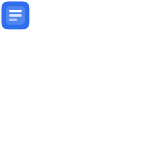
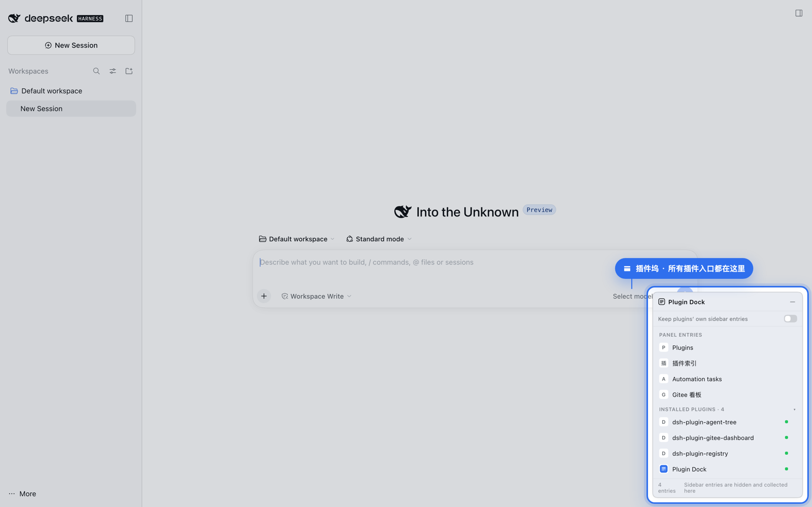
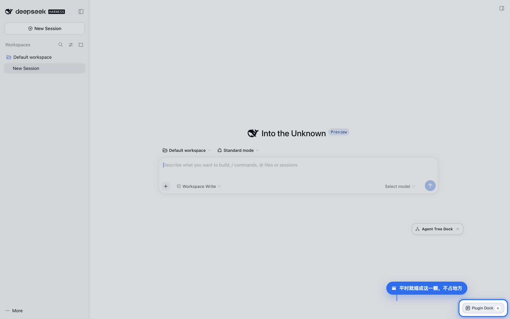
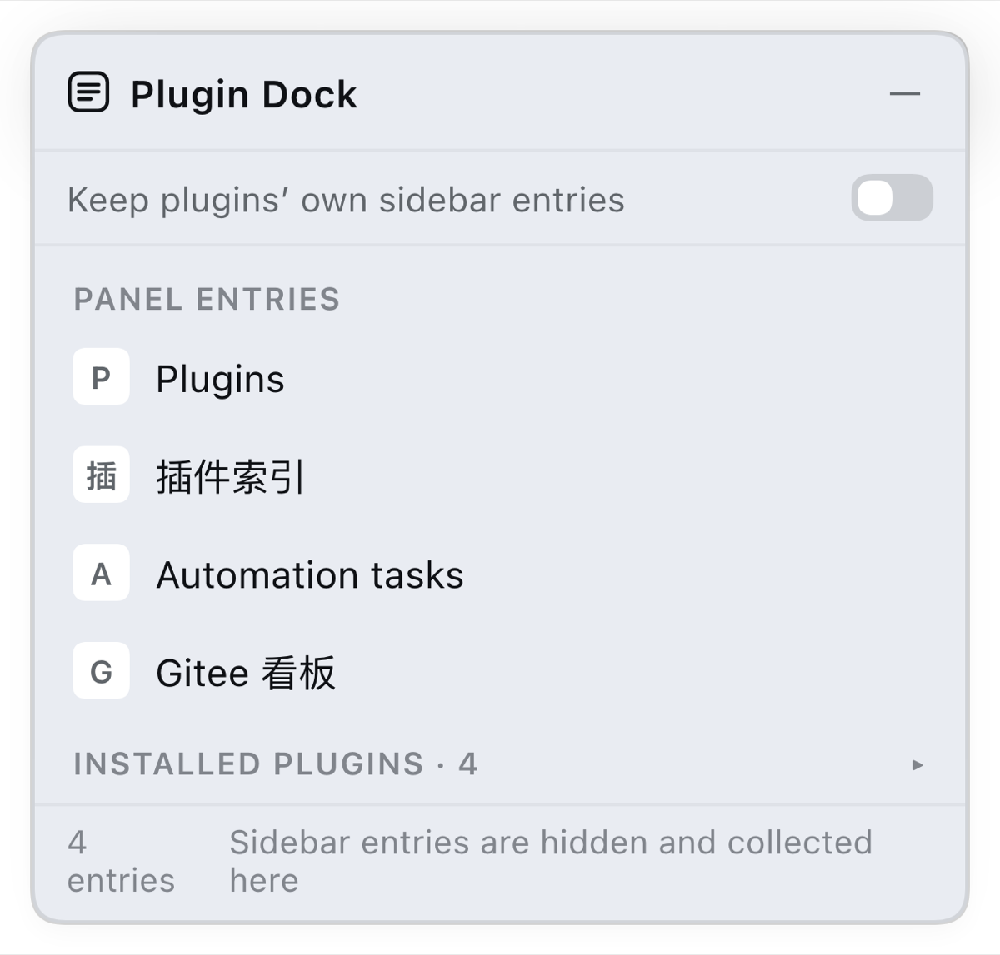
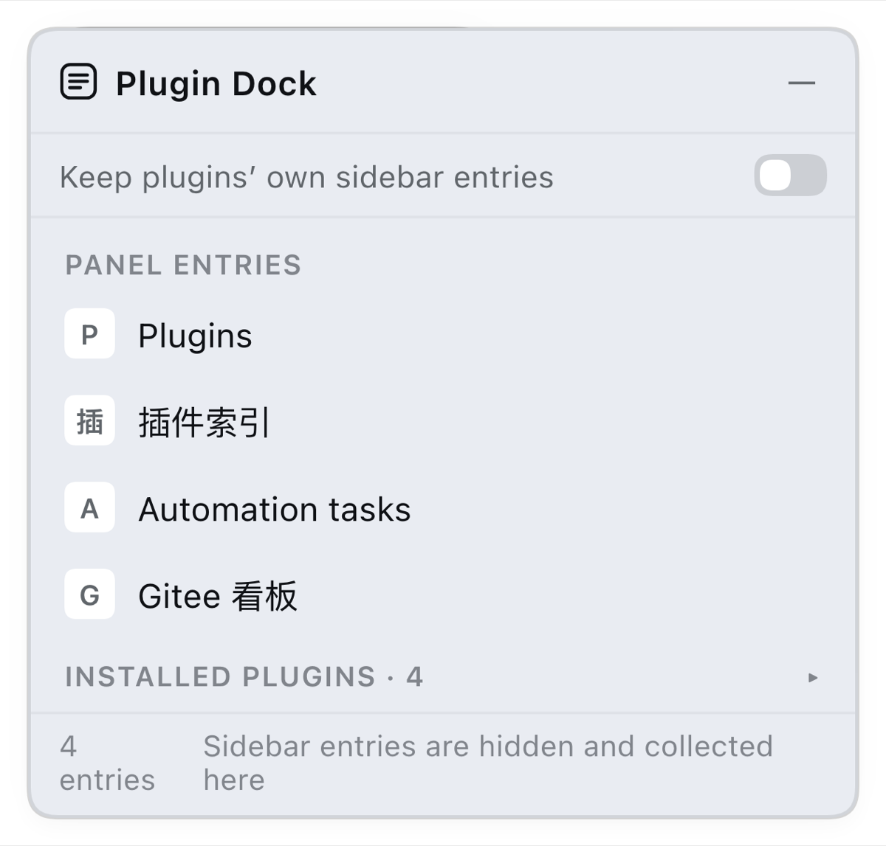

<p align="center"></p>

<h1 align="center">Plugin Dock · 插件坞</h1>

<p align="center">
  <a href="https://www.npmjs.com/package/dsh-plugin-dock"></a>
  <a href="https://www.npmjs.com/package/dsh-plugin-dock"></a>
  =0.2.1-rc.2 <0.3.0">
  <a href="LICENSE"></a>
</p>

<p align="center">
  Every plugin's left-sidebar entry in the DSH Web GUI, collected into one collapsible floating card.<br>
  <b>Takes over on install</b>: the icon column is hidden right away and every entry lives in the card.
</p>



## Why

The more DSH plugins you install, the longer that column of plugin icons gets — one more entry per plugin, you have to recognise which icon is which, and it competes with the session list for width. Plugin Dock folds that column into one card:

- **Collapsed it is a small pill** with an entry counter — out of the way;
- **Expanded it is a list**: click a row to switch to that plugin's panel, the current one is highlighted;
- **On by default**: the switch ships off (= dock mode), so the sidebar icon column is hidden and every entry lives in the card; flip it on to restore the plugin's own sidebar entries (applies immediately);
- **Plus an "Installed plugins" section**: what is installed in the current profile and which are running — click a row to jump to its detail page in the Plugins panel.

## Install

Requires DSH `>=0.2.1-rc.2 <0.3.0` (Web GUI).

```bash
dsh plugin --profile web add dsh-plugin-dock
```

Reload the page and the pill shows up in the bottom-right corner. Alternatively:

- search `dsh-plugin-dock` in DSH's **Add plugin** dialog;
- install from the plugin market (awesome-dsh-plugin);
- for local development use a `link:` install, see [docs/install.en.md](docs/install.en.md).

## A closer look

<p align="center">
  
  <br><sub>Collapsed: the UI looks the same, plus one pill in the corner</sub>
</p>

<p align="center">
  
  
  <br><sub>Left: panel entries, click a row to switch · Right: installed plugins with status dots, click a row for details</sub>
</p>

## Usage

| Action | Result |
| --- | --- |
| Click the pill | expand the card |
| Drag the pill / header | move the window (kept inside the viewport) |
| Click a panel row | switch to that panel |
| Click `←` | back to the conversation |
| Click `—` | collapse to the pill |
| Flip the switch | dock mode on / off (immediately) |

Position, collapsed state and the switch live in `localStorage`, so it reopens exactly as you left it.

## What it touches (and what it does not)

- Adds exactly **one** entry to `shell.overlay` (the frame-wide floating layer); nothing else in the UI is modified.
- Sidebar icons are **neither removed nor rewritten**: with the switch on it does nothing; with it off it applies a single CSS rule to the sidebar `<nav>` (see limitations).
- No Harness client package is imported — only `require('react')`; styles use `--dsw-*` theme tokens and follow light/dark.
- The installed-plugins list comes from host remotes (`pluginInventory` / `pluginManager`), never from local files.

Internal contract and fallbacks: [docs/compat.md](docs/compat.md).

## Known limitations

1. **Dock mode relies on one CSS anchor**: `nav[class*="panelList"]{display:none!important}`, matching the sidebar's global panel-icon group (hashed class names in the current build are stable). If upstream changes that DOM the rule silently stops matching — the switch becomes a no-op, the page is never broken. Replace it once upstream ships an official hide API.
2. **Footer action buttons are not collected.** Entries in `sidebar.footer.action` are per-plugin **action components** (clicking runs plugin-internal logic), not addressable panels; the slot API does not let one plugin render or trigger another's components. Only panel entries are collected.
3. Panel icons are each plugin's own component instance and cannot be rendered by another plugin, so panel rows use a first-character badge; the installed list uses host-provided base64 icons.
4. There is no public mapping between a panel row and its npm package, so the two sections are listed separately rather than de-duplicated.
5. Screenshots are captured from the real running page (isolated profile + headless Chrome), but visuals and interaction still cannot be asserted automatically; `verify/smoke.mjs` covers contract and static checks only.

## Development

```bash
node verify/smoke.mjs                      # contract + slots + locale + privacy scan (seconds, offline)
node scripts/build-public-bundle.mjs       # build the public repository content into dist/public
```

`scripts/build-public-bundle.mjs` copies a whitelist of public files only, rewrites the package identity (npm name / patch / ModuleLoader id), and runs a privacy scan (local paths, tokens, private endpoints) — it only emits output when there are zero hits.

## License

[MIT](LICENSE) © 2026 Yuna
