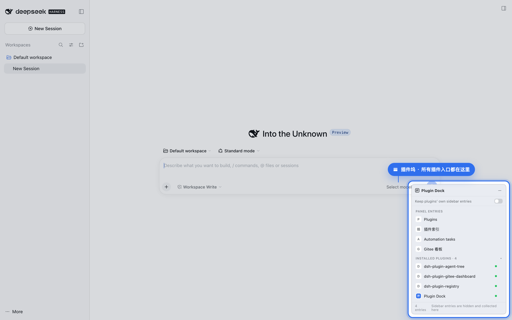
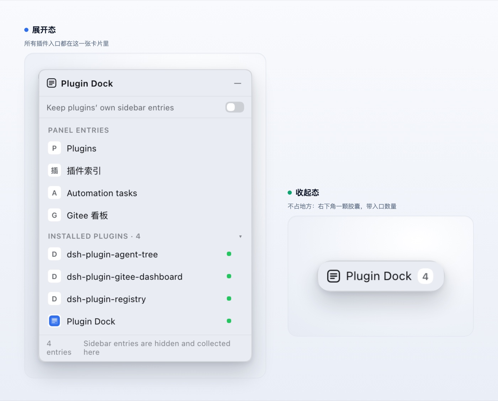

# 插件坞 · Plugin Dock

> 把 DSH 左侧栏那一排插件入口，收进右下角一张可折叠的浮卡。**装好即接管**——左侧栏立刻清空，所有入口只在这一张卡片里。

[](https://www.npmjs.com/package/dsh-plugin-dock) [](docs/compat.md) [](LICENSE)



## 为什么装它

DSH 装得越多，左侧栏那排插件图标就越长——每加一个插件多一个入口，想找某个面板得在图标堆里认，还会和会话列表抢宽度。插件坞把这排入口收进一张卡片：

- **平时只是一颗小胶囊**（带入口数量角标），不占地方；
- **点开是一张列表**：点一行直接切到那个插件的面板，当前所在面板高亮；
- **装好就生效**：开关默认关闭 = 集中模式，左侧栏那排图标收起，所有入口都在这张卡片里；想恢复插件自己的侧栏入口，把开关打开就行（立即生效）；
- **还多一段「已安装插件」**：当前 profile 里装了什么、哪个开着，一目了然；点一行跳到它在 Plugins 面板里的详情页。

## 安装

要求：DSH `>=0.2.1-rc.2 <0.3.0`（Web GUI）。

```bash
dsh plugin --profile web add dsh-plugin-dock
```

装完刷新页面，右下角会出现「插件坞」胶囊。也可以：

- 在 DSH 的 **Add plugin** 弹窗里搜包名 `dsh-plugin-dock`；
- 从插件市场（awesome-dsh-plugin）安装；
- 本地开发用 `link:` 安装，见 [docs/install.md](docs/install.md)。

## 一眼看懂

左边是展开的卡片，右边是收起后的样子——都只是右下角那一小块：



- **展开**：面板入口一排排列出来，点一行就切过去；下面还有「已安装插件」，带运行状态点。
- **收起**：整张卡缩成一颗胶囊，只占右下角一点地方，角标 `4` 是入口数量。

## 怎么用

| 动作 | 结果 |
| --- | --- |
| 点胶囊 | 展开卡片 |
| 按住胶囊 / 标题栏拖动 | 移动窗口（自动限制在视口内） |
| 点某一行面板 | 切到那个面板 |
| 点「←」 | 主区域切回对话 |
| 点「—」 | 收回胶囊 |
| 切开关 | 集中模式开 / 关（立即生效） |

位置、折叠状态、开关状态都存在 `localStorage`，下次打开还是原样。

## 它动了什么、没动什么

- 只往 `shell.overlay`（整帧浮动层）**加**一个条目，其余 UI 完全不碰。
- 侧栏图标**不删不改**：开关打开时完全不动；开关关闭时只对侧栏里那一个 `<nav>` 打一条 CSS 规则（见「已知限制」）。
- 不 import 任何 Harness Client 包，只 `require('react')`；样式只用 `--dsw-*` 主题 token，跟随明暗主题。
- 已安装插件清单走 Host 的 Remote（`pluginInventory` / `pluginManager`），不读本地文件。

依赖的内部契约与降级行为见 [docs/compat.md](docs/compat.md)。

## 已知限制

1. **集中模式依赖一条 CSS 锚点**：`nav[class*="panelList"]{display:none!important}`。它命中的是侧栏「全局面板图标」那一组（当前构建的 class 局部名稳定）。若上游改了这段 DOM，规则会匹配不到 → 开关变成「无效果」，不会弄坏页面。上游若提供官方隐藏 API，应替换掉这条规则。
2. **侧栏底部的动作按钮不纳入**。`sidebar.footer.action` 里的是插件自己渲染的**动作按钮**（点击执行插件内部逻辑），不是可跳转的页面；slot API 不允许别的插件代为渲染或触发别人的组件，所以这里只收纳「面板入口」。
3. 插件图标是各插件自己的组件实例，另一个插件无法渲染 → 面板行用「首字」做占位徽标；已安装插件那段用 Host 提供的 base64 图标。
4. 面板行与安装包之间没有公开的归属关系（无法从包名映射到 panel id），所以两段分开显示，不做去重。
5. 截图是在**真实运行的 DSH 页面**里拍的（隔离 profile + 无头 Chrome + CDP 操作），不是拼图；但视觉与交互仍无法自动化断言，`verify/smoke.mjs` 只覆盖契约与静态检查。

## 开发

```bash
node verify/smoke.mjs                      # 契约 + 槽位 + locale + 隐私扫描（秒级，不联网）
node scripts/build-public-bundle.mjs       # 生成可公开的仓库内容 dist/public
```

`scripts/build-public-bundle.mjs` 是白名单构建：只复制公开文件，重写包身份（npm 包名 / patch / ModuleLoader id），并做隐私扫描（本机路径、token、私有端点），0 命中才产出。

## 许可

[MIT](LICENSE) © 2026 Yuna
